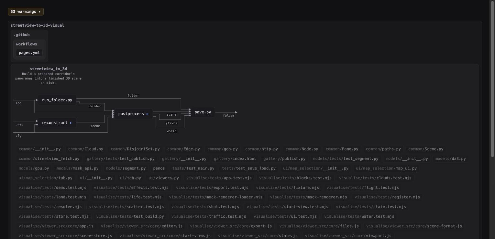

# visual-code

A project is a machine. Folders are machines, files are parts, and each machine's
`main.py` only wires its parts together. This tool draws that machine from the code,
and checks the code against the rules it assumes.



## Use

```bash
npm link                      # once, to get the `visual-code` command
visual-code <project>         # diagram at http://localhost:4400, updates live
visual-code check <project>   # prints each rule break as path:line, non-zero on any
```

Node only, no dependencies. The viewer bundles React Flow and ELK.

## Rules

[`RULES.md`](RULES.md) — 21 rules covering machines and parts, wires and ports, tools
and endpoints. The checker reports the subset that can be found statically.

## As a Claude Code skill

`skill/visual-code/` is a skill: copy it into `.claude/skills/` and an agent can
restructure a project against the rules and show you the result.

More screenshots in [`showcase/`](showcase/).
