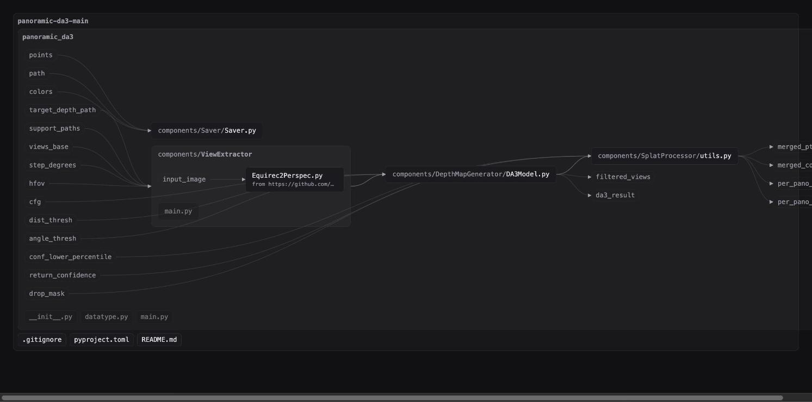
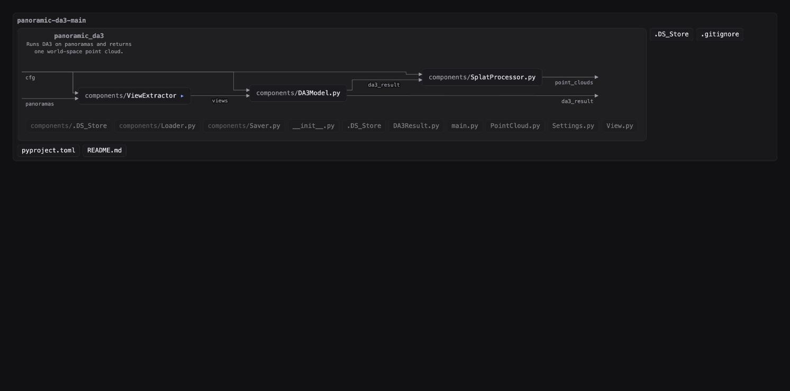

# visual-code

**Understand your project visually when coding with AI**

A problem with agentic coding is losing control and understanding of the project when you move too fast. This aims to facilitate understanding of your project visually through visual diagrams when coding. It does so by:

1. Providing a live diagram of your code.
2. A set of rules and linter checks to enforce the code in a pattern similar to flow based programming.

## Before and after applying

| Before | After |
|---|---|
|  |  |

## Use

Needs Node 20+.

```bash
git clone https://github.com/YellowO2/visual-code.git
cd visual-code && npm link

visual-code <project>          # live diagram at localhost:4400
visual-code check <project>    # rule breaks as path:line
```

For Claude Code, add the skill:

```bash
ln -s "$PWD/skill/visual-code" ~/.claude/skills/visual-code
```

Python projects only for now.

## License

MIT
