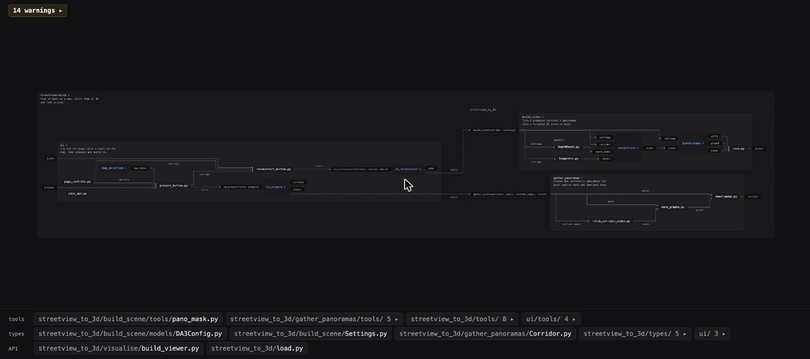

# visual-code

**Understand your project visually when coding with AI**

AI writes code fast, and you lose track of what it built. This project provides:

1. **A live diagram of your code.** Folders are machines, files are parts, and lines are values passing between them.
2. **Rules a linter checks.** They keep the code in a pattern similar to flow based programming.



## The idea

A folder is a component, where `main.py` defines wirings.
Full rules: [`RULES.md`](RULES.md). They borrow from [flow-based programming](https://jpaulm.github.io/fbp/), dependency injection and [ports and adapters](https://alistair.cockburn.us/hexagonal-architecture/).

## Before and after

| Before | After |
|---|---|
|  |  |

## Use

> Set up visual-code from https://github.com/YellowO2/visual-code, then use it to restructure this project.

Python projects only, for now.

<details>
<summary>Setup steps (your agent follows these)</summary>

Needs Node 20+.

```bash
git clone https://github.com/YellowO2/visual-code.git
cd visual-code && npm link
ln -s "$PWD/skill/visual-code" ~/.claude/skills/visual-code
```

Then `visual-code <project>` shows the diagram and `visual-code check <project>` lists rule breaks.

</details>

## Develop

```bash
npm install && npm run build
```

## License

MIT
