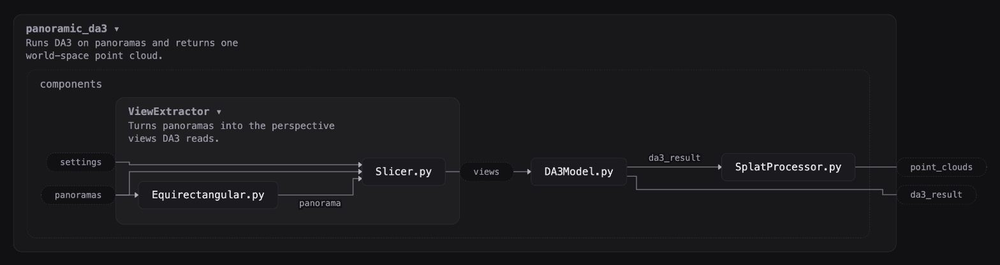

# visual-code

**Understand your project visually when coding with AI**

A problem with agentic coding is losing control and understanding of the project when you move too fast. This aims to facilitate understanding of your project visually through visual diagrams when coding. It does so by:

1. Providing a live diagram of your code.
2. A set of rules and linter checks to enforce the code in a pattern similar to flow based programming.

## Example



## Use

Needs Node 20+.

```bash
git clone https://github.com/YellowO2/visual-code.git
cd visual-code && npm link

visual-code <project>          # live diagram at localhost:4400
visual-code check <project>    # rule breaks as path:line
```

For Claude Code, add the skill:

```bash
ln -s "$PWD/skill/visual-code" ~/.claude/skills/visual-code
```

Python projects only for now.

### Shared values

A value that goes to four places or more, like the settings, is not drawn as
long wires: each place it goes gets a short one, from a label naming where it
comes from (`Loaders, Hardware ─▸ learn.py`). What enters the program from
outside, like its settings, is not drawn at all: no part hands it over.

### What a value is

Hovering a machine's port, or a wire's name, shows what the value is: the
opening line of its type's file. A port's type comes from the `main.py`
signature (`history: History`); a wire's from the port of the same name, or
the type named after it (`decision` -> `Decision`).

### Seeing inside a model

A file that offers `_example()`, returning a built PyTorch model and a tuple
of example inputs at the sizes it really runs at, gets a **model** button on its box. It opens the box in
place, in the diagram, to the model drawn the way papers draw networks (fully connected layers, embeddings,
recurrent layers, convolutions, transformer blocks), with each block's sizes,
what goes in and out, its parameters and the comment next to it in the code
on hover. Each input is shown by its argument's name, with what it is when the
block's `forward` docstring has a line for it, as `uv (B, T, N, 2) the current
guess`. A pattern of blocks repeated back to back is drawn once, in a frame
marked with how many times it repeats. The model runs once on the example inputs to read this, in the
Python given by `--python` (or `VISUAL_CODE_PYTHON`; default `python3`), which
must be able to import the project.

```python
def _example():
    return Brain(hidden=64), (torch.zeros(1, 75, 76), torch.zeros(1, 75, dtype=torch.long))
```

## License

MIT
